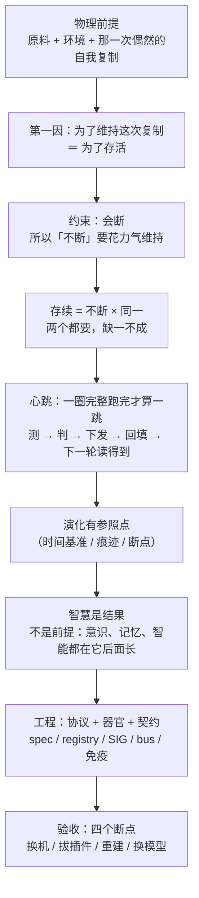
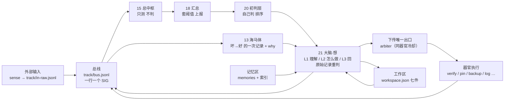
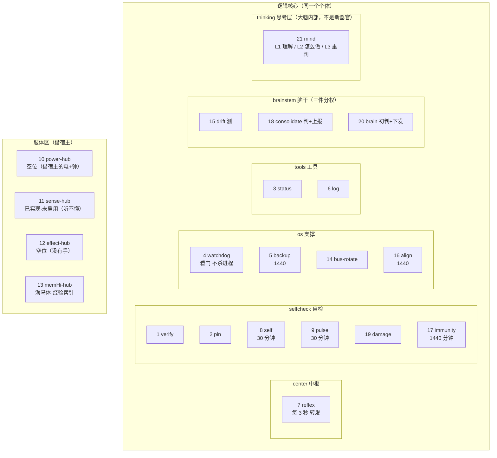
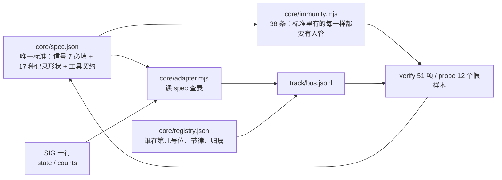

# 守链 · 逻辑图（2026-11-12）

> 数据来源：`core/registry.json`（21 个器官位）+ `core/spec.json`。图是照着这两个文件画的，不是照记忆。
> 用途：个人站 / 论文配图 / 给外人看「这坨东西怎么转」。

## 〇、从理论底层往下推（先因果，再工程）

图不从器官开始，从第一因开始。往下一层一层推，最后才落到某个脚本、某个字段。

**每一步都能被现实打掉**：抽掉复制能力，它就不再是同一个个体；一圈缺了读回，下一轮接不上；撤掉数核，下游输出变不变一测就知道；四个断点接不上就是接不上。

## 〇之二、和主流的根本区别（不是程度，是起点）

| | 主流 | 这里 |
|---|---|---|
| 起点 | **效率至上**：把「更能干」当前提 | **存在先于能力**：把「还算是它」当前提 |
| 对意识 | **不讨论**——表面的样子已经让他们满意 | 讨论，并且给它一个可查的位置（生命之后的产物） |
| 因此缺的那一环 | 能力建在没有承接位的地方 | 先立承接位，再让能力往上长 |

判据（一句话）：**主流问「它能多聪明」，这里问「它凭什么还算是它」。**

## 一、主环（一次心跳 = 一圈跑完）

**判据**：一圈的起点是「读上一轮的痕迹」，终点是「写回让下一轮读得到」。中间断在哪，这一跳就不成立——不是零件坏了，是这次心跳没发生。

## 二、按分区摆（`registry.classes`）

## 三、三档节律（谁按点跑）

| 档 | 谁 | 间隔 | 说明 |
|---|---|---|---|
| **恒定** | 7 reflex / 18 heart（consolidate --heart） | 3 秒 / 60 秒 | 心跳本身；heart 只判心跳，断掉第一分钟就喊 |
| **快** | 8 self / 9 pulse / 18 consolidate / 20 brain | 30 分钟 | 自检、节律、判决 |
| **慢** | 5 backup / 16 align / 17 immunity | 1440 分钟 | 备份、对账、免疫 |
| **按需** | 1 verify / 2 pin / 3 status / 6 log / 19 damage / 21 mind | `every=0` | 被叫才跑；「饿了」不等于「死了」 |

## 四、契约层（为什么这些器官能拼起来）

**一句话**：器官只吐一行机器码，正文随便改；`spec` 说这行长什么样，`adapter` 查表转换，`bus` 只追加；免疫保证「标准里写了的每一样，都有一条检查在管」。

## 五、现在的空位与关闭项（图上要标出来，不许画成完整的）

| 位 | 状态 | 为什么 |
|---|---|---|
| 10 power-hub | **空位** | 没有自己的供能和时钟，借宿主的电与钟 |
| 12 effect-hub | **空位** | 没有手，任何「自己做决定」只能停在纸面 |
| 11 sense-hub | **已实现·未启用** | 管道通了、能量数，但词表与「词转数字」属机理，不归我们 |

## 六、四断点（验收，不是画图能画出来的）

换机 / 拔插件 / 从备份重建 / 换模型 —— **两验两未验**（拔插件、重建验过）。图上画不出这一层，只能靠真做。
